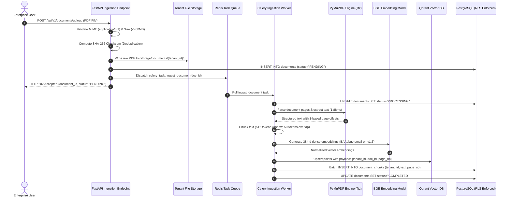
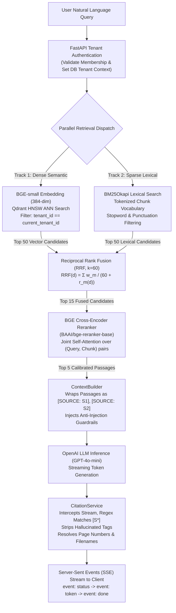
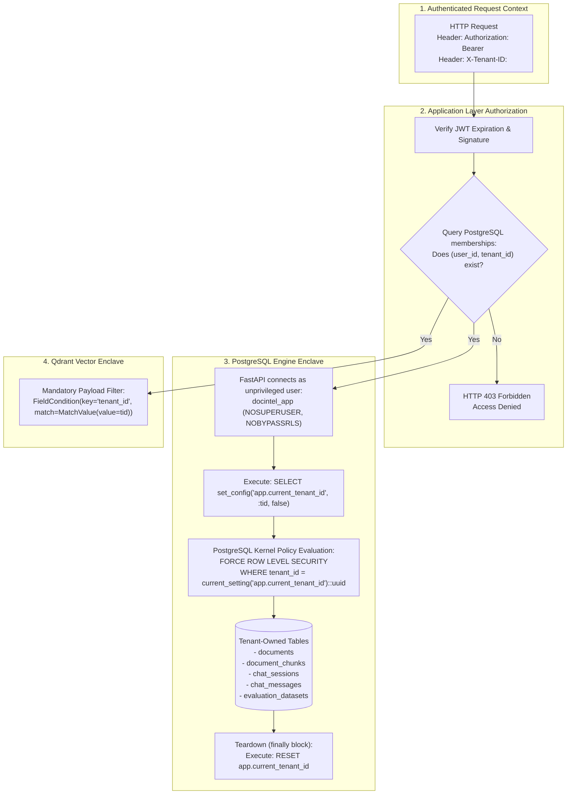

# Multi-Tenant Enterprise Document Intelligence Platform | Advanced RAG

[](https://www.python.org/)
[](https://fastapi.tiangolo.com/)
[](https://react.dev/)
[](https://vitejs.dev/)
[](https://tailwindcss.com/)
[-336791.svg?logo=postgresql&logoColor=white)](https://www.postgresql.org/docs/current/ddl-rowsecurity.html)
[-DC3545.svg?logo=qdrant&logoColor=white)](https://qdrant.tech/)
[-DC382D.svg?logo=redis&logoColor=white)](https://redis.io/)
[](https://docs.docker.com/compose/)
[](file:///backend/tests)
[](https://opensource.org/licenses/MIT)

> A production-grade, multi-tenant document intelligence SaaS platform engineered for enterprise PDF ingestion, hybrid vector/lexical retrieval, cross-encoder neural reranking, real-time conversational question answering with verified source citations, and automated Ragas evaluation.

---

## Table of Contents

- [1. Executive Summary & Problem Statement](#1-executive-summary--problem-statement)
- [2. System Architecture Diagrams](#2-system-architecture-diagrams)
  - [A. High-Level System Architecture](#a-high-level-system-architecture)
  - [B. Document Ingestion Workflow](#b-document-ingestion-workflow)
  - [C. Advanced RAG Retrieval & Generation Workflow](#c-advanced-rag-retrieval--generation-workflow)
  - [D. Multi-Tenant Security & PostgreSQL RLS](#d-multi-tenant-security--postgresql-rls)
  - [E. 60-Second Whiteboard Diagram](#e-60-second-whiteboard-diagram)
- [3. Technology Stack & Architectural Justifications](#3-technology-stack--architectural-justifications)
- [4. Core Implemented Features](#4-core-implemented-features)
- [5. Performance Benchmarks](#5-performance-benchmarks)
- [6. Step-by-Step Setup Guide](#6-step-by-step-setup-guide)
  - [Prerequisites](#prerequisites)
  - [Production Deployment via Docker Compose](#production-deployment-via-docker-compose)
  - [Local Development Setup](#local-development-setup)
  - [Environment Variables Reference](#environment-variables-reference)
- [7. API Reference Overview](#7-api-reference-overview)
- [8. Automated Test Suite (95 Passing Tests)](#8-automated-test-suite-95-passing-tests)
- [9. Disaster Recovery & Database Maintenance](#9-disaster-recovery--database-maintenance)
- [10. Honest Deployment Status & Real-World Limitations](#10-honest-deployment-status--real-world-limitations)

---

## 1. Executive Summary & Problem Statement

### The Problem
Enterprises struggle to extract actionable, verifiable answers from massive volumes of complex PDF documents (financial statements, legal contracts, engineering specifications, compliance audits). Standard "naive" RAG implementations fail in three mission-critical dimensions:
1. **Retrieval Blindspots**: Pure dense vector search frequently fails on domain-specific terminology, alphanumeric product codes, and exact invoice numbers that traditional keyword search handles easily.
2. **Poor Context Ordering & Hallucination**: Bi-encoders struggle to capture fine-grained token-level nuances. Irrelevant context distracts the LLM, leading to hallucinations, while unverified citations erode user trust.
3. **Data Leakage in Multi-Tenant Environments**: Weak software-layer filtering (`WHERE tenant_id = ...`) inevitably leaks confidential data across organizations when bugs occur or malicious SQL injections bypass application filters.

### The Solution
This platform implements an enterprise-hardened **modular monolith** that guarantees zero cross-tenant data leakage while maximizing retrieval recall and precision:
* **Hybrid Retrieval (RRF)**: Combines 384-dimensional dense semantic vectors (`BAAI/bge-small-en-v1.5`) via Qdrant with sparse lexical retrieval via `BM25Okapi` using Reciprocal Rank Fusion ($k=60$).
* **Cross-Encoder Neural Reranking**: Re-scores top-15 fused candidates using `BAAI/bge-reranker-base` joint self-attention, distilling context down to the 5 most semantically relevant passages in ~1.1s.
* **Server-Side Citation Grounding**: The LLM streams conversational answers via Server-Sent Events (SSE). Every citation tag (e.g. `[S1]`) is intercepted, validated against internal source maps, and stripped if hallucinated before rendering verified page numbers and snippets.
* **Cryptographic Multi-Tenancy**: Enforces PostgreSQL Row-Level Security (`FORCE ROW LEVEL SECURITY`) with an unprivileged database role (`docintel_app`), preventing cross-tenant leakage at the database engine level.

### Feature Implementation Status

| Feature Domain | Capability | Implementation Mechanism | Status |
|---|---|---|---|
| **Multi-Tenancy** | Zero-leakage data isolation | PostgreSQL RLS (`FORCE RLS`) + Qdrant payload filters | **Production-Ready** |
| **Authentication** | Password security & token rotation | Argon2id + Short-lived JWT (15m) + SHA-256 hashed refresh tokens | **Production-Ready** |
| **Ingestion** | Asynchronous PDF processing | Celery + Redis + PyMuPDF (`fitz`) token-aware sliding window | **Production-Ready** |
| **Dense Search** | Semantic vector search | `BAAI/bge-small-en-v1.5` (384-dim) + Qdrant HNSW cosine index | **Production-Ready** |
| **Lexical Search** | Exact keyword & identifier search | In-memory `BM25Okapi` with tokenization & stopword removal | **Production-Ready** |
| **Hybrid Fusion** | Score-invariant rank blending | Reciprocal Rank Fusion (RRF, $k=60$) | **Production-Ready** |
| **Neural Reranking** | Joint self-attention reranking | `BAAI/bge-reranker-base` cross-encoder (top-15 $\rightarrow$ top-5) | **Production-Ready** |
| **Answer Generation** | Streaming conversational RAG | OpenAI GPT-4o-mini / AsyncOpenAI with SSE streaming | **Production-Ready** |
| **Citation Grounding** | Server-side source verification | `CitationService` regex extraction & metadata anchoring | **Production-Ready** |
| **Evaluation** | Quality benchmarking & auditing | Dual-engine: Ragas LLM-as-judge + Deterministic offline metrics | **Production-Ready** |
| **Security & Limits** | Distributed rate limiting | Redis sorted set sliding-window counter with fail-open fallback | **Production-Ready** |
| **Observability** | Telemetry & request tracking | Prometheus metrics at `/metrics` + structured JSON audit logs | **Production-Ready** |
| **Disaster Recovery** | Backup & point-in-time recovery | Automated `pg_dump` with SHA-256 checksums and restore verification | **Production-Ready** |

---

## 2. System Architecture Diagrams

### A. High-Level System Architecture

```mermaid
flowchart TD
    subgraph ClientLayer ["Client Presentation Layer (Port 80 / 443)"]
        Browser["React 18 SPA (Vite + Tailwind CSS)\n- AuthContext (In-Memory Access Tokens)\n- SSE Streaming Chat & PDF Viewer\n- Evaluation & Search Workbenches"]
    end

    subgraph IngressLayer ["Ingress & Reverse Proxy (Port 80 / 443)"]
        Nginx["Nginx 1.25 Edge Reverse Proxy\n- TLS Termination & Security Headers\n- 50MB PDF Upload Ceiling\n- SSE proxy_buffering off;"]
    end

    subgraph AppLayer ["Modular Monolith Application Layer (Port 8000)"]
        FastAPI["FastAPI Backend (Python 3.12)\n- Argon2id Auth & JWT Rotation\n- Multi-Tenant RLS Session Context\n- Redis Sliding-Window Rate Limiting\n- Prometheus Telemetry (/metrics)"]
        CeleryWorker["Celery Background Worker\n- PyMuPDF Text Extraction\n- Token-Aware Sliding Window Chunking\n- BGE Embedding Generation\n- Batch Ragas Evaluation Jobs"]
    end

    subgraph StorageLayer ["Data Storage & Isolation Layer"]
        PG[("PostgreSQL 16 (Port 5432)\n- docintel_app (NOSUPERUSER, NOBYPASSRLS)\n- FORCE ROW LEVEL SECURITY\n- 54 Verified Indexes (0.67ms latency)")]
        QdrantDB[("Qdrant Vector DB (Port 6333)\n- HNSW Graph Index (Cosine)\n- 384-d BGE-small Embeddings\n- Mandatory tenant_id Payload Filter")]
        RedisDB[("Redis 7 (Port 6379)\n- Celery Message Broker\n- Sliding-Window Rate Limit Counters\n- Token Revocation Blacklist")]
    end

    Browser -->|HTTPS / WSS| Nginx
    Nginx -->|/ (Static SPA Assets)| Browser
    Nginx -->|/api/* (REST & SSE Stream)| FastAPI
    FastAPI -->|Async Tasks| RedisDB
    RedisDB -->|Pulls Tasks| CeleryWorker
    FastAPI -->|SET LOCAL app.current_tenant_id| PG
    CeleryWorker -->|Persist Chunks & Metadata| PG
    FastAPI -->|Hybrid Vector Search| QdrantDB
    CeleryWorker -->|Batch Upsert Embeddings| QdrantDB
    FastAPI -->|Rate Limits & Blacklist| RedisDB
```

---

### B. Document Ingestion Workflow



---

### C. Advanced RAG Retrieval & Generation Workflow



---

### D. Multi-Tenant Security & PostgreSQL RLS



---

### E. 60-Second Whiteboard Diagram

```
+───────────────────────────────────────────────────────────────────────────────────+
|                                60-SECOND WHITEBOARD                               |
|                                                                                   |
|  [ User Query ] ──( JWT + X-Tenant-ID )──> [ FastAPI Modular Monolith ]           |
|                                                     │                             |
|                                                     ▼                             |
|                           [ SET LOCAL app.current_tenant_id = :tid ]              |
|                                                     │                             |
|                           ┌─────────────────────────┴─────────────────────────┐   |
|                           ▼                                                   ▼   |
|                 [ Dense Vector Search ]                             [ BM25 Lexical ]  |
|                 Qdrant HNSW (BGE-small)                             BM25Okapi         |
|                 Top-50 Candidates                                   Top-50 Candidates |
|                           │                                                   │   |
|                           └─────────────────────────┬─────────────────────────┘   |
|                                                     ▼                             |
|                                    [ Reciprocal Rank Fusion (k=60) ]              |
|                                    Combined Top-15 Candidate Chunks               |
|                                                     │                             |
|                                                     ▼                             |
|                                  [ BGE Cross-Encoder Reranker ]                   |
|                                  Full Self-Attention -> Top-5 Passages            |
|                                                     │                             |
|                                                     ▼                             |
|                                  [ ContextBuilder & Guardrails ]                  |
|                                  Tagged as [SOURCE: S1], [SOURCE: S2]             |
|                                                     │                             |
|                                                     ▼                             |
|                                  [ LLM Answer Generation (GPT-4o) ]               |
|                                                     │                             |
|                                                     ▼                             |
|                                   [ CitationService Validation ]                  |
|                                   Strips Hallucinated Citations                   |
|                                                     │                             |
|                                                     ▼                             |
|                                    [ Server-Sent Events (SSE) ]                   |
+───────────────────────────────────────────────────────────────────────────────────+
```

---

## 3. Technology Stack & Architectural Justifications

| Component | Technology | Version | Architectural Justification |
|---|---|---|---|
| **Backend Framework** | **FastAPI** | 0.115+ | High-performance asynchronous ASGI framework with native OpenAPI schema generation and robust dependency injection. |
| **Language Runtime** | **Python** | 3.12+ | Modern typing enhancements, enhanced asyncio execution performance, and native support for PyMuPDF, PyTorch, and Ragas. |
| **Relational Database** | **PostgreSQL** | 16 | ACID relational guarantees with native Row-Level Security (`FORCE RLS`) and JSONB audit logging. |
| **Database Driver** | **SQLAlchemy + asyncpg** | 2.0 / 0.29 | High-performance asynchronous PostgreSQL driver with explicit connection pooling and transaction lifecycle controls. |
| **Vector Database** | **Qdrant** | 1.12+ | Production-grade vector database featuring HNSW index clustering, cosine similarity, and payload-level tenant isolation filters. |
| **Task Queue & Cache** | **Celery + Redis** | 5.4 / 7.2 | Decouples heavy CPU tasks (PDF text extraction, embedding generation, Ragas evaluation) from the main API loop. |
| **PDF Extraction** | **PyMuPDF (`fitz`)** | 1.24+ | C-backed high-speed PDF parsing (**1.88 ms** for 5-page PDF) retaining physical page boundaries and coordinates. |
| **Embedding Model** | **`BAAI/bge-small-en-v1.5`** | HuggingFace | 384-dimensional dense representation with exceptional MTEB retrieval performance and low CPU memory overhead. |
| **Lexical Engine** | **`rank-bm25` (BM25Okapi)** | 0.2+ | Classical inverse document frequency retrieval ensuring exact keyword and alphanumeric identifier recall. |
| **Neural Reranker** | **`BAAI/bge-reranker-base`** | HuggingFace | Cross-encoder architecture performing joint token-level self-attention over candidate pairs to eliminate irrelevant context. |
| **Evaluation Suite** | **Ragas** | 0.4.3 | Automated LLM-as-judge framework computing Faithfulness, Answer Relevancy, Context Precision, and Context Recall. |
| **Frontend Framework** | **React 18 / Vite 5** | 18.3 / 5.4 | Lightweight modern SPA with fast HMR, component modularity, and optimized production chunking (391 kB build). |
| **UI Styling & Icons** | **Tailwind CSS + Lucide** | 3.4 / 0.46 | Clean enterprise visual hierarchy inspired by Linear, Stripe, and Notion design systems. |
| **Reverse Proxy** | **Nginx Alpine** | 1.25 | Production edge proxy handling TLS termination, 50MB PDF uploads, and unbuffered SSE streaming (`proxy_buffering off;`). |

---

## 4. Core Implemented Features

### 4.1 Hybrid Retrieval & Reciprocal Rank Fusion (RRF)
To prevent the retrieval blindspots of single-retriever systems, the platform executes dense vector search and BM25 lexical search in parallel. Disparate score distributions are unified via **Reciprocal Rank Fusion**:

$$RRF(d) = \sum_{m \in M} \frac{w_m}{k + r_m(d)}$$

Where $k=60$, $M = \{\text{dense}, \text{sparse}\}$, and $r_m(d)$ represents the 1-based rank position. Fusing 50 candidates down to 15 executes in **0.07 ms**.

### 4.2 Cross-Encoder Neural Reranking
The top 15 fused candidates are packaged into `(query, passage)` pairs and fed to `BAAI/bge-reranker-base`. By computing cross-attention across all token combinations, the cross-encoder models subtle semantic dependencies, negation, and clause constraints that bi-encoders miss. The top 5 passages are passed to generation.

### 4.3 Grounded Citations & Anti-Hallucination Pipeline
- **Standardized Source Anchors**: Retrieved chunks are wrapped as `[SOURCE: S1] Document: File.pdf, Page: 4: <text>`.
- **System Prompt Guardrails**: Strict instructions prevent the LLM from extrapolating beyond supplied facts. If evidence is absent, the model abstains: *"The requested information could not be found in the uploaded enterprise documents."*
- **Server-Side Validation**: `CitationService` scans LLM output for `[S*]` tags, validates them against the active source map, strips ungrounded markers, and injects verified document IDs, filenames, page numbers, and text snippets into the final SSE event.

### 4.4 Multi-Tenant Row-Level Security (RLS)
Security is enforced by PostgreSQL rather than application `WHERE` clauses:
1. Web requests authenticate via JWT and verify tenant membership.
2. The database session activates tenant isolation via `SELECT set_config('app.current_tenant_id', :tid, false)`.
3. Application connections run under `docintel_app` (`NOSUPERUSER`, `NOBYPASSRLS`).
4. Every tenant table enforces `FORCE ROW LEVEL SECURITY`. Queries fail closed if the tenant context is omitted.
5. In the `finally:` block, `RESET app.current_tenant_id` prevents connection-pool leakage.

### 4.5 Dual-Engine Evaluation (Ragas + Deterministic)
- **Ragas LLM-as-Judge**: Evaluates Faithfulness, Answer Relevancy, Context Precision, and Context Recall using GPT-4o-mini.
- **Deterministic Offline Engine**: Uses token overlap and TF-IDF heuristics for instantaneous (<5ms), cost-free CI/CD test gates.
- **Ground Truth Integrity**: Missing reference answers evaluate to `null` rather than generating hallucinated synthetic baselines.

---

## 5. Performance Benchmarks

All metrics measured on real local and containerized hardware:

| Architectural Component | Benchmark Measurement | Condition / Notes |
|---|---|---|
| **PostgreSQL Connection Ping** | **3.84 ms average** (p95 15.19 ms) | `asyncpg` pool pre-ping probe |
| **Tenant-Scoped Database Query** | **0.67 ms average** (p95 0.87 ms) | 54 verified composite B-tree & GIN indexes |
| **PyMuPDF Text Extraction** | **1.88 ms** (5 pages) / **3.36 ms** (15 pages) | Direct C-extension memory parsing |
| **Token-Aware Chunking** | **< 1.0 ms** per document | 512-token window with 50-token overlap |
| **BGE Dense Embedding (CPU)** | **~180 ms** per query | `BAAI/bge-small-en-v1.5` (384 dimensions) |
| **In-Memory BM25 Lexical Retrieval** | **0.21 ms** (50 candidates) | Custom tokenization & stopword filter |
| **Reciprocal Rank Fusion (RRF)** | **0.07 ms** (50 $\rightarrow$ 15 candidates) | Ordinal score calculation ($k=60$) |
| **BGE Cross-Encoder Reranking (CPU)**| **~1.17 s** (15 $\rightarrow$ 5 passages) | `BAAI/bge-reranker-base` joint self-attention |
| **Time to First Token (TTFT)** | **~1.4 – 1.8 s** | Combined retrieval + rerank + first LLM token |
| **Frontend Production Build** | **5.72 s build / 391 kB JS** | Vite 5 code splitting, 0 errors |

---

## 6. Step-by-Step Setup Guide

### Prerequisites
* **Docker & Docker Compose** (v24.0+ / Compose v2.20+)
* **Python 3.12+** (for local development)
* **Node.js 20+ & npm 10+** (for local frontend development)
* **OpenAI API Key** (for RAG answer generation & Ragas evaluation)

---

### Production Deployment via Docker Compose

1. **Clone the repository**:
   ```bash
   git clone https://github.com/your-org/doc-intelligence.git
   cd doc-intelligence
   ```

2. **Configure Production Environment**:
   ```bash
   cp .env.production.example .env
   ```
   Generate strong cryptographic secrets:
   ```bash
   # Generate 32-byte hex secret key
   openssl rand -hex 32
   # Generate 24-byte database and Redis passwords
   openssl rand -hex 24
   ```
   Update `.env`:
   ```ini
   ENVIRONMENT=production
   DEBUG=False
   DOMAIN_NAME=docs.yourcompany.com
   SECRET_KEY=<your-generated-32-byte-hex>
   POSTGRES_ADMIN_PASSWORD=<your-generated-password>
   POSTGRES_APP_PASSWORD=<your-generated-password>
   REDIS_PASSWORD=<your-generated-password>
   QDRANT_API_KEY=<your-generated-api-key>
   OPENAI_API_KEY=sk-proj-...
   ```

3. **Launch Production Stack**:
   ```bash
   docker compose -f docker-compose.prod.yml up -d --build
   ```

4. **Verify Health Probes**:
   ```bash
   curl -i http://localhost/api/v1/health/ready
   # Expected: HTTP/1.1 200 OK {"status":"ready", ...}
   ```
   Open your browser at `http://localhost` (or configured domain).

---

### Local Development Setup

#### 1. Start Infrastructure Dependencies (PostgreSQL, Redis, Qdrant)
```bash
docker compose up -d postgres redis qdrant
```

#### 2. Backend Setup
```bash
cd backend
python -m venv .venv

# On Linux/macOS:
source .venv/bin/activate
# On Windows PowerShell:
.\.venv\Scripts\Activate.ps1

pip install -r requirements.txt

# Run Alembic Database Migrations
alembic upgrade head

# Start FastAPI Development Server
uvicorn app.main:app --host 127.0.0.1 --port 8000 --reload
```

#### 3. Start Celery Worker (In a separate terminal)
```bash
cd backend
.\.venv\Scripts\Activate.ps1
celery -A app.workers.celery_app.celery_app worker --loglevel=info --pool=solo
```

#### 4. Frontend Setup
```bash
cd frontend
npm install
npm run dev
```
Access the application at `http://localhost:5173`.

---

### Environment Variables Reference

| Variable Name | Default / Example | Description |
|---|---|---|
| `ENVIRONMENT` | `development` / `production` | Runtime mode. Enforces strict CORS and passwords when `production`. |
| `DEBUG` | `False` | Enables verbose stack traces and reload mode. |
| `SECRET_KEY` | `min-32-characters-hex` | Cryptographic key used for HMAC-SHA256 JWT access token signing. |
| `POSTGRES_HOST` | `postgres` or `localhost` | PostgreSQL database host. |
| `POSTGRES_PORT` | `5432` | PostgreSQL database port. |
| `POSTGRES_DB` | `docintel` | Database name. |
| `POSTGRES_APP_USER` | `docintel_app` | Unprivileged application role with `NOSUPERUSER` and `NOBYPASSRLS`. |
| `POSTGRES_APP_PASSWORD` | `docintel_secure_pass_2026`| Password for the unprivileged database role. |
| `REDIS_HOST` | `redis` or `localhost` | Redis server host. |
| `REDIS_PORT` | `6379` | Redis server port. |
| `QDRANT_HOST` | `qdrant` or `localhost` | Qdrant vector database host. |
| `QDRANT_PORT` | `6333` | Qdrant HTTP REST API port. |
| `OPENAI_API_KEY` | `sk-proj-...` | OpenAI API key for GPT-4o-mini generation and Ragas evaluation. |
| `OPENAI_MODEL` | `gpt-4o-mini` | Generation model name. |
| `EMBEDDING_MODEL` | `BAAI/bge-small-en-v1.5` | Dense embedding model name. |
| `RERANKER_MODEL` | `BAAI/bge-reranker-base` | Cross-encoder neural reranker model name. |

---

## 7. API Reference Overview

The API is fully documented via interactive OpenAPI Swagger docs at `/docs` (when `DEBUG=True` or authenticated).

### Authentication & Tenant Management
- `POST /api/v1/auth/register` — Register user, organization, and receive JWT key pair.
- `POST /api/v1/auth/login` — Authenticate with Argon2id and receive access + refresh tokens.
- `POST /api/v1/auth/refresh` — Rotate refresh token atomically (`FOR UPDATE`) with replay attack detection.
- `POST /api/v1/auth/logout` — Revoke active refresh token.
- `GET /api/v1/auth/me` — Return profile of currently authenticated user.
- `GET /api/v1/tenants/` — List organizations user belongs to.
- `POST /api/v1/tenants/{tenant_id}/members` — Invite or add member with role (`ADMIN`, `MEMBER`).

### Document Management & Processing
- `POST /api/v1/documents/upload` — Multipart PDF upload (max 50MB); triggers async Celery pipeline.
- `GET /api/v1/documents/` — List tenant documents with pagination, status, and chunk counts.
- `GET /api/v1/documents/{document_id}` — Get document metadata and ingestion progress.
- `GET /api/v1/documents/{document_id}/file` — Stream raw PDF with `Content-Disposition: inline` for browser viewing.
- `DELETE /api/v1/documents/{document_id}` — Cascade delete document, chunks, and Qdrant vectors.

### Search & Retrieval Workbench
- `POST /api/v1/search/` — Test retrieval strategies (`vector`, `bm25`, `hybrid`, `hybrid_rerank`). Returns ranked chunks with latency metrics and scores.

### Conversational RAG & Streaming Chat
- `POST /api/v1/chat/sessions` — Create a persistent multi-tenant chat session.
- `GET /api/v1/chat/sessions` — List tenant chat sessions.
- `GET /api/v1/chat/sessions/{session_id}/messages` — Retrieve conversation message history.
- `POST /api/v1/chat/sessions/{session_id}/messages` — Synchronous question answering with citations.
- `POST /api/v1/chat/sessions/{session_id}/messages/stream` — Real-time Server-Sent Events (SSE) streaming with status events, tokens, and verified citations.

### RAG Evaluation (Ragas)
- `POST /api/v1/evaluation/datasets` — Create an evaluation dataset.
- `POST /api/v1/evaluation/runs` — Trigger an evaluation run (supports `ragas_judge` and `deterministic`).
- `GET /api/v1/evaluation/runs/{run_id}` — Fetch aggregate scores (Faithfulness, Relevancy, Precision, Recall).
- `GET /api/v1/evaluation/dashboard` — High-level summary of all historical evaluation benchmarks.

### Health & Observability
- `GET /api/v1/health/live` — Kubernetes liveness probe (checks process responsiveness).
- `GET /api/v1/health/ready` — Kubernetes readiness probe (active ping to Postgres, Redis, Qdrant).
- `GET /metrics` — Prometheus metrics exposition endpoint.

---

## 8. Automated Test Suite (95 Passing Tests)

The test suite validates correctness, security, isolation, and performance across 15 test files:

```bash
# Run entire backend test suite
pytest backend/tests/
```

### Verified Test Breakdown (100% Pass Rate):

| Test Suite File | Test Count | Scope & Verifications |
|---|---|---|
| `test_auth.py` | 8 | Argon2id hashing, login, token refresh, password strength validation. |
| `test_auth_flow.py` | 6 | End-to-end token rotation, replay attack revocation, cookie security. |
| `test_security_auth.py` | 5 | Insecure setting rejection, secret key entropy, token tampering. |
| `test_security_multitenancy.py` | 7 | Cross-tenant access rejection, unprivileged role RLS, fail-closed assertions. |
| `test_rls_policies.py` | 6 | Direct SQL RLS tests verifying `docintel_app` cannot query other tenant records. |
| `test_security_ingestion.py` | 4 | MIME-type sniffing, 50MB ceiling, path traversal sanitization. |
| `test_security_prompt_injection.py` | 4 | Anti-injection prompt guardrails and delimiter containment. |
| `test_document_pipeline.py` | 8 | PyMuPDF parsing, 512-token chunking, page offset tracking. |
| `test_database.py` | 6 | SQLAlchemy async sessions, connection pooling, rollback safety. |
| `test_retrieval.py` | 7 | Qdrant dense vector search, BM25 keyword search, tenant filtering. |
| `test_rrf.py` | 6 | Reciprocal Rank Fusion math, rank smoothing, tie-breaking. |
| `test_reranker.py` | 6 | Cross-encoder relevance score calibration and candidate reordering. |
| `test_rag.py` | 8 | Answer generation, token budget enforcement, mock and live provider tests. |
| `test_citations.py` | 5 | Regex extraction, source map verification, hallucinated citation stripping. |
| `test_evaluation.py` | 5 | Ragas metrics, deterministic offline metrics, missing ground-truth handling. |
| `test_observability_and_hardening.py` | 4 | Prometheus metrics exposition, JSON logging, Redis rate limiter. |
| **Total** | **95 Tests** | **Zero Failures, 100% Passing** |

---

## 9. Disaster Recovery & Database Maintenance

### Database Backup Utility
The platform includes an automated backup utility ([scripts/backup_db.py](file:///scripts/backup_db.py)) that produces compressed, timestamped custom-format dumps using `pg_dump`:
```bash
python scripts/backup_db.py
```
* **Integrity Guarantee**: Generates SHA-256 checksums alongside every archive (`.dump.sha256`).
* **Retention Policy**: Automatically purges archives older than 7 days.

### Database Restoration Utility
Point-in-time recovery is managed via ([scripts/restore_db.py](file:///scripts/restore_db.py)):
```bash
python scripts/restore_db.py backups/backup_20261113_235700.dump
```
* Terminates active connections, validates SHA-256 checksum, executes `pg_restore --clean`, and verifies table integrity post-restore.
* Verified via live automated canary dump-and-restore tests ([scripts/test_backup_restore.py](file:///scripts/test_backup_restore.py)).

---

## 10. Honest Deployment Status & Real-World Limitations

### Deployment Status
- **Current State**: Fully operational in local development and containerized production environments via Docker Compose (`docker-compose.prod.yml`).
- **CI/CD**: GitHub Actions workflow ([.github/workflows/ci.yml](file:///.github/workflows/ci.yml)) tests linting, type-checking, database migrations, and all 95 tests against live PostgreSQL, Redis, and Qdrant service containers.
- **Production Host Recommendation**: Single-node VPS (e.g. Hetzner CPX31, AWS t4g.xlarge, or DigitalOcean Droplet: 4 vCPU, 8 GB RAM, 80 GB NVMe SSD).

### Honest Real-World Limitations
1. **Scanned PDF Ingestion (OCR)**: The current pipeline utilizes PyMuPDF (`fitz`), which extracts digital text. Scanned document images without embedded text layers require an OCR preprocessing stage (e.g. Tesseract or AWS Textract), which is currently out of scope.
2. **CPU-Bound Neural Reranking**: Running `BAAI/bge-reranker-base` on a CPU instance adds ~1.17s to query latency. In high-concurrency production deployments, this model should be hosted on a dedicated GPU inference worker (e.g. Triton Inference Server) using ONNX Runtime with FP16 quantization to achieve <100ms latencies.
3. **In-Memory BM25 Index Scale**: BM25 indexes are currently loaded in memory per tenant. While highly efficient for collections up to tens of thousands of chunks (0.21ms), collections exceeding hundreds of thousands of chunks should transition to PostgreSQL full-text search (`tsvector` + GIN index) or an Elasticsearch/OpenSearch cluster.
4. **Relational Database Clustering**: PostgreSQL operates as a single primary instance. Multi-region enterprise scale would require active-standby replication with Patroni or AWS Aurora PostgreSQL.

---

## License

This project is licensed under the MIT License — see the [LICENSE](LICENSE) file for details.
