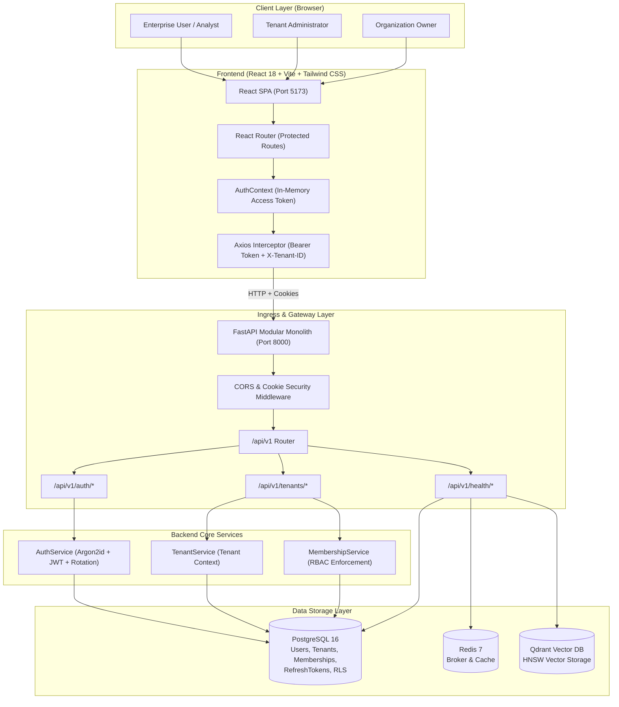
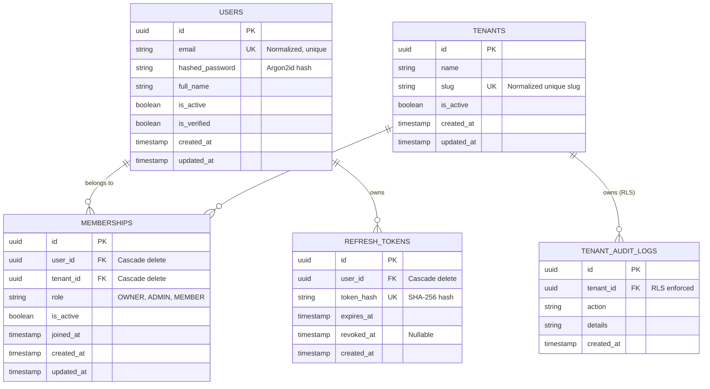
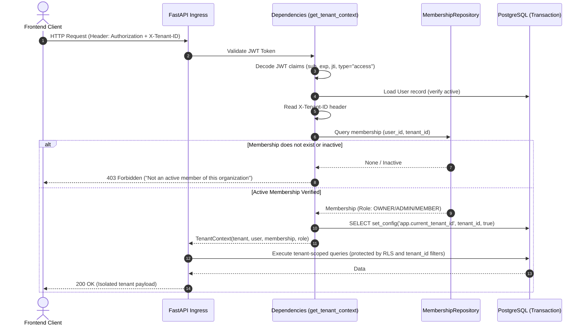
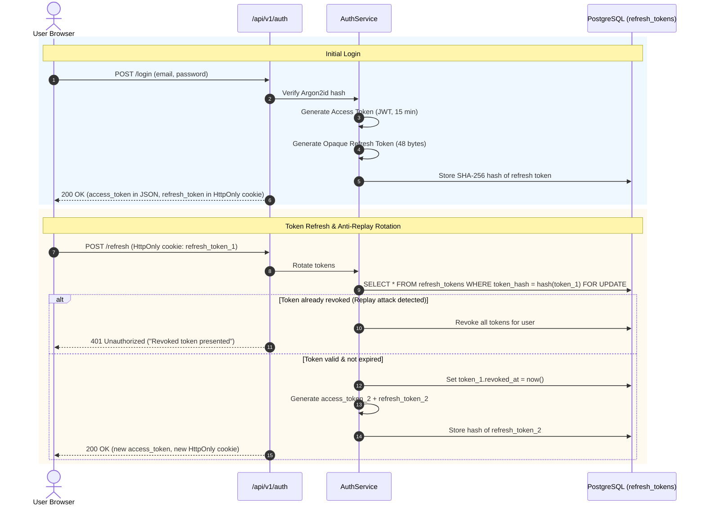
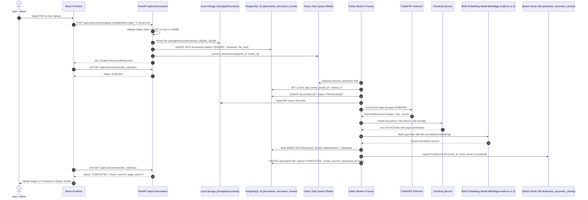
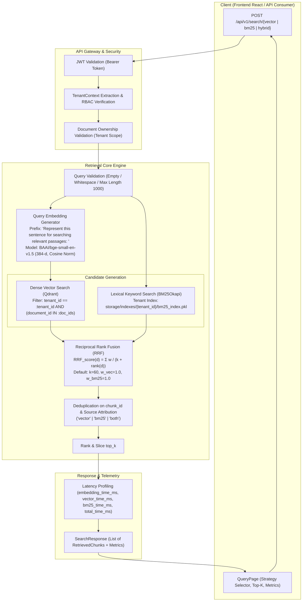
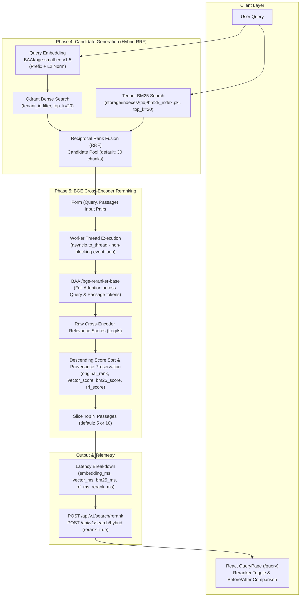
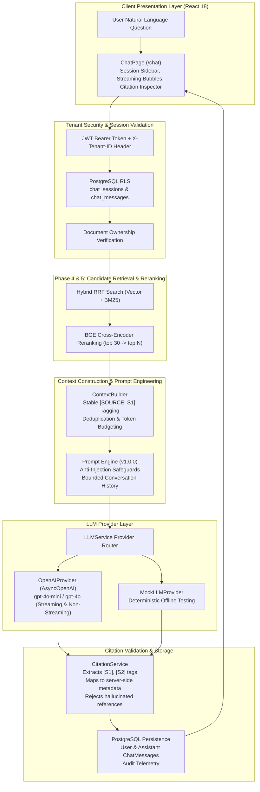
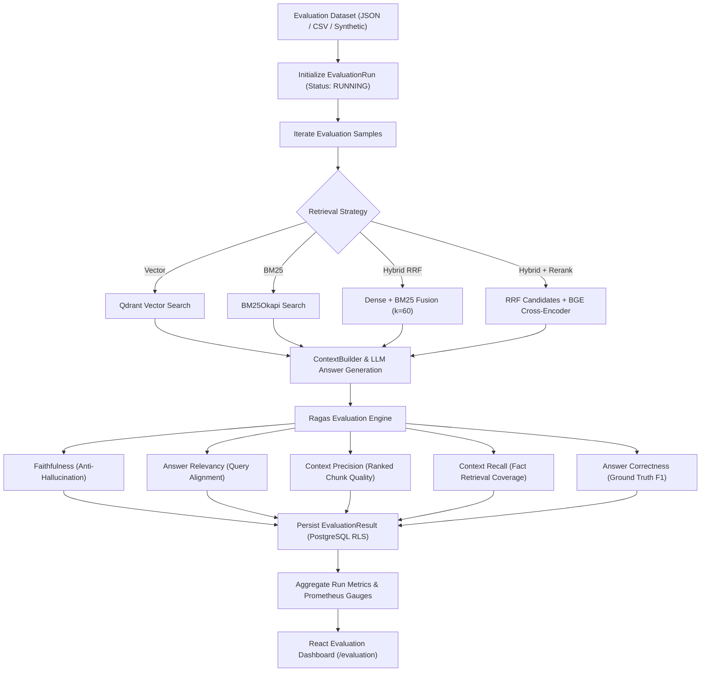
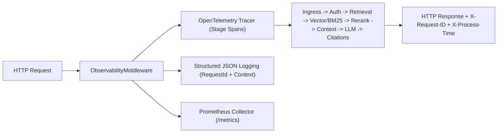

# Architecture Design Document
## Multi-Tenant Enterprise Document Intelligence Platform

**Document Version:** 7.0.0  
**Phase:** Phase 7 – RAG Evaluation using Ragas, Observability, and Production Hardening  
**Status:** Approved & Implemented  

---

## 1. Executive Summary & Architectural Principles

The **Multi-Tenant Enterprise Document Intelligence Platform** enables multi-tenant organizations to ingest sensitive enterprise PDF documents and execute high-precision queries using a hybrid Retrieval-Augmented Generation (RAG) pipeline with cryptographic tenant boundaries.

### Core Architectural Decisions:
1. **Modular Monolith**: Unidirectional layered architecture (`API` → `Services` → `Repositories` → `DB`) with strict dependency injection.
2. **Dual-Tier Multi-Tenant Isolation**:
   - *Application Layer*: Client-provided `X-Tenant-ID` is never trusted directly. It is validated against the authenticated user's active membership in PostgreSQL. An authenticated `TenantContext` is constructed per-request.
   - *Database Layer (PostgreSQL RLS)*: Transaction-local `SELECT set_config('app.current_tenant_id', :tid, true)` activates Row-Level Security policies with fail-closed behavior.
   - *Vector Storage (Qdrant)*: Payload-level tenant isolation filters mathematically restrict all similarity searches to the authenticated organization.
3. **Enterprise Authentication**: Argon2id password hashing, cryptographically signed short-lived JWT access tokens (15m), and high-entropy opaque refresh tokens (7d) stored exclusively as SHA-256 hashes with atomic database row-locking (`FOR UPDATE`) to defeat concurrent replay attacks.
4. **Role-Based Access Control (RBAC)**: Centralized authorization dependencies enforcing `OWNER`, `ADMIN`, and `MEMBER` privilege boundaries with last-owner preservation guarantees.

---

## 2. High-Level System Architecture

---

## 3. Database Schema & Entity Relationships

### Table Specifications & Constraints:
1. **`users`**:
   - `id`: UUID (v4) Primary Key.
   - `email`: Normalized to lowercase before storage. Unique constraint `ix_users_email`.
   - `hashed_password`: Argon2id hash (never plaintext).
2. **`tenants`**:
   - `id`: UUID (v4) Primary Key.
   - `slug`: Normalized alphanumeric + hyphen slug. Unique constraint `ix_tenants_slug`.
3. **`memberships`**:
   - `id`: UUID (v4) Primary Key.
   - Unique constraint: `uq_membership_user_tenant` on `(user_id, tenant_id)`. Prevents duplicate memberships.
   - `role`: Enum `OWNER`, `ADMIN`, `MEMBER`.
   - Foreign keys to `users.id` and `tenants.id` with `ON DELETE CASCADE`.
4. **`refresh_tokens`**:
   - `id`: UUID (v4) Primary Key.
   - `token_hash`: 64-character SHA-256 hex digest of the raw token.
   - Row-level database locking (`FOR UPDATE OF refresh_tokens`) prevents concurrency race conditions during token rotation.
5. **`tenant_audit_logs` (RLS Foundation)**:
   - Row-Level Security enabled (`ENABLE ROW LEVEL SECURITY`) and forced (`FORCE ROW LEVEL SECURITY`).
   - Policy: `tenant_isolation_policy` enforces `tenant_id::text = NULLIF(current_setting('app.current_tenant_id', true), '')`.

---

## 4. Multi-Tenant Context & Isolation Safeguards

### Defense in Depth Principles:
1. **Never Trust Client Tenant Headers**: Every request passes through `_resolve_tenant_context()`, confirming that the authenticated user possesses an active membership for the requested tenant.
2. **Transaction-Scoped PostgreSQL Variable**: `set_config('app.current_tenant_id', :tid, true)` applies `is_local = true`, guaranteeing that tenant context automatically terminates at the end of the HTTP request transaction and never leaks into connection pools.
3. **Fail-Closed Behavior**: When `app.current_tenant_id` is missing or empty, PostgreSQL RLS returns 0 rows.

---

## 5. Role-Based Access Control (RBAC) Permission Matrix

| Operation | Endpoint | OWNER | ADMIN | MEMBER |
| :--- | :--- | :---: | :---: | :---: |
| **List User Organizations** | `GET /api/v1/tenants` | Yes | Yes | Yes |
| **View Organization Profile** | `GET /api/v1/tenants/{id}` | Yes | Yes | Yes |
| **Update Organization Settings** | `PATCH /api/v1/tenants/{id}` | Yes | No (403) | No (403) |
| **List Organization Members** | `GET /api/v1/tenants/{id}/members` | Yes | Yes | No (403) |
| **Add Regular Member** | `POST /api/v1/tenants/{id}/members` (role=MEMBER) | Yes | Yes | No (403) |
| **Add/Promote Admin** | `POST /api/v1/tenants/{id}/members` (role=ADMIN) | Yes | No (403) | No (403) |
| **Assign Owner Role** | `POST /api/v1/tenants/{id}/members` (role=OWNER) | Yes | No (403) | No (403) |
| **Remove Regular Member** | `DELETE /api/v1/tenants/{id}/members/{user_id}` | Yes | Yes | No (403) |
| **Remove Administrator** | `DELETE /api/v1/tenants/{id}/members/{admin_id}` | Yes | No (403) | No (403) |
| **Remove Owner** | `DELETE /api/v1/tenants/{id}/members/{owner_id}` | Yes (if >1 owner) | No (403) | No (403) |
| **Remove Sole Active Owner** | `DELETE /api/v1/tenants/{id}/members/{owner_id}` | No (400) | No (403) | No (403) |

---

## 6. Authentication Workflow & Token Rotation

---

## 7. Frontend Integration Architecture

- **`AuthContext.jsx`**: Centralized authentication state provider.
- **In-Memory Token Security**: JWT access tokens are stored in memory (React state) and never saved in `localStorage`.
- **HttpOnly Cookie for Refresh**: Long-lived refresh tokens are stored in `HttpOnly`, `SameSite=Lax` cookies, preventing XSS token exfiltration.
- **Single-Flight Refresh Locking**: Axios response interceptor uses a Promise queue (`failedQueue`) to prevent multiple simultaneous 401 responses from triggering concurrent refresh calls and rotating token race conditions.
- **Protected Routes**: `<ProtectedRoute>` guards workspace routes and presents a loading state during session restoration.
- **Organization Switcher**: Dropdown in `<Navbar>` enables users with multiple memberships to switch active tenants instantly, setting the `X-Tenant-ID` header across all API requests.

---

## 8. Summary of Completed Deliverables (Phase 2)

1. **Database Models & Constraints**: `users`, `tenants`, `memberships`, `refresh_tokens`, `tenant_audit_logs`.
2. **Alembic Migrations**: `2026_11_13_0001` migration script with upgrade, downgrade, and Row-Level Security policies.
3. **Security Engine**: Argon2id password hashing, PyJWT access tokens, SHA-256 hashed refresh tokens.
4. **Tenant Context**: Request-scoped `TenantContext` dependency with verified membership checks and transaction-local `set_config` RLS setting.
5. **RBAC Engine**: `OWNER`, `ADMIN`, `MEMBER` roles with strict privilege boundaries and sole-owner safety checks.
6. **API Endpoints**: 5 Auth endpoints, 7 Tenant and Member management endpoints.
7. **Frontend Experience**: Functional Login, Register, Tenant Switcher, Member Directory with invite and removal capabilities.
8. **Automated Test Suite**: 35 automated tests executing against real PostgreSQL and Redis.

---

## 9. Phase 3: Enterprise Document Management & Ingestion Pipeline

### Pipeline Architecture

### Ingestion Components & Data Models

1. **Storage Layer (`LocalStorageService`)**:
   - Files are stored under `storage/documents/{tenant_id}/{document_id}.pdf`.
   - Path traversal guards enforce boundaries within `settings.STORAGE_LOCAL_DIR`.
   - Abstract `BaseStorageService` enables seamless drop-in of Amazon S3 or Google Cloud Storage.

2. **Database Models & PostgreSQL RLS**:
   - `Document`: Tracks upload metadata, file size, SHA-256 checksum, MIME type, page count, chunk count, error messages, and lifecycle status (`PENDING`, `QUEUED`, `PROCESSING`, `COMPLETED`, `FAILED`, `DELETING`).
   - `DocumentChunk`: Relational text chunks linked to documents with `chunk_index`, `page_number`, `token_count`, and `chunk_metadata` (JSONB).
   - PostgreSQL Row-Level Security policies (`documents_tenant_isolation_policy` and `chunks_tenant_isolation_policy`) guarantee fail-closed multi-tenant data isolation.

3. **PyMuPDF Text Extraction (`PDFService`)**:
   - Validates `%PDF-` signature in first 1024 bytes.
   - Page-by-page extraction preserving 1-indexed page boundaries.
   - Robust cleanup of carriage returns and empty whitespace.

4. **Recursive Text Chunking (`ChunkingService`)**:
   - Configurable chunk size (default 500 tokens / characters) and overlap (100 tokens).
   - Hierarchical splitting across paragraphs (`\n\n`), sentences (`. `, `? `), and word boundaries.
   - Retains page provenance and token count approximations.

5. **BGE Embeddings (`EmbeddingService`)**:
   - Model: `BAAI/bge-small-en-v1.5` (384-dimensional dense vectors).
   - `normalize_embeddings=True` for cosine similarity matching.
   - Singleton cached model with deterministic fallback for offline/isolated environments.

6. **Qdrant Vector Storage (`QdrantService`)**:
   - Collection: `enterprise_document_chunks` (384 dimensions, Cosine distance).
   - Point IDs match PostgreSQL chunk UUIDs exactly for 1-to-1 traceability.
   - Payload indexes on `tenant_id` and `document_id` for deterministic tenant-scoped similarity filtering.

7. **Cascading Deletion Engine**:
   - Cascades deletions across Qdrant vector points, physical disk storage files, and PostgreSQL chunks/documents.

---

## 10. Advanced Retrieval Architecture (Vector Search, BM25 & Hybrid RRF)

Phase 4 implements an enterprise-grade Information Retrieval subsystem combining semantic vector embeddings and lexical keyword indexing fused via Reciprocal Rank Fusion (RRF).

### Retrieval Flow

### Retrieval Components & Algorithms

1. **BGE Query Embedding Service (`EmbeddingService.embed_query`)**:
   - Model: `BAAI/bge-small-en-v1.5` (384-dimensional dense vectors).
   - Retrieval Prefix: Prepends `"Represent this sentence for searching relevant passages: "` to queries as required by BGE for asymmetric retrieval.
   - Normalization: L2 unit normalization ensuring inner product matches cosine similarity.
   - Validation: Rejects empty, whitespace-only, or queries exceeding 1000 characters.

2. **Semantic Vector Search (`QdrantService.search_chunks_async`)**:
   - Mandatory Filter: Every query executes with a server-constructed payload condition `MatchValue(key="tenant_id", value=str(tenant_id))`.
   - Document-Level Filtering: Optional `document_ids` filter restricted strictly to validated tenant documents.
   - Post-search Assertion: Inspects returned payload `tenant_id` to prevent cross-tenant vector leakage.

3. **Tenant-Isolated BM25 Lexical Service (`BM25Service`)**:
   - In-memory index caching (`TenantBM25Index`) backed by persistent disk storage (`storage/indexes/{tenant_id}/bm25_index.pkl`).
   - Thread safety: Protected by `threading.RLock()` across concurrent searches and incremental updates.
   - Robust BM25 IDF Smoothing (`RobustBM25Okapi`): Implements Lucene-standard positive IDF smoothing $\ln\left(1 + \frac{N - n + 0.5}{n + 0.5}\right)$ ensuring positive scores for small collections ($N \le 2$).
   - Tokenization: Preserves technical identifiers, acronyms, and compound tokens (e.g., `bge-small-en-v1.5`, `PostgreSQL_16`, `SHA-256`).
   - Ingestion Hook: New chunks automatically indexed in Celery worker upon ingestion completion.
   - Deletion Hook: Chunks purged synchronously upon document deletion.

4. **Reciprocal Rank Fusion (`RRFService.fuse_results`)**:
   - Formula:
     $$\text{RRF}(d) = \sum_{m \in \{\text{vector}, \text{bm25}\}} \frac{w_m}{k + \text{rank}_m(d)}$$
     where $k = 60$, $w_{\text{vector}} = 1.0$, $w_{\text{bm25}} = 1.0$, and $\text{rank}(d) \in \{1, 2, \dots\}$.
   - Deduplication: Merges candidates matching the same `chunk_id`.
   - Source Attribution: Chunks labeled with `retrieval_sources` as `"vector"`, `"bm25"`, or `"both"`.

5. **Search API Endpoints**:
   - `POST /api/v1/search/vector`: Semantic vector similarity search.
   - `POST /api/v1/search/bm25`: BM25 lexical keyword search.
   - `POST /api/v1/search/hybrid`: Hybrid RRF search combining dense and keyword candidates.
   - Latency Instrumentation: Sub-millisecond timing tracking query embedding, vector lookup, BM25 search, and end-to-end execution.

---

## 11. BGE Cross-Encoder Reranking Architecture (Phase 5)

Phase 5 introduces a deep neural reranking stage utilizing the `BAAI/bge-reranker-base` cross-encoder model to refine candidate ordering generated by Phase 4's hybrid retrieval engine.

### Neural Retrieval Pipeline

### Architectural Principles & Distinctions

#### 1. Bi-Encoder vs. Cross-Encoder
- **Bi-Encoder (`BAAI/bge-small-en-v1.5`)**:
  - Encodes query and passages into independent 384-dimensional dense vectors: $f(q)$ and $f(p)$.
  - Similarity computed via vector dot product: $\cos(\theta) = \langle f(q), f(p) \rangle$.
  - Scalable for millions of points via HNSW graphs in Qdrant, but lacks cross-attention between individual query and passage tokens.
- **Cross-Encoder (`BAAI/bge-reranker-base`)**:
  - Feeds query and passage jointly into the Transformer architecture: $f([q; p])$.
  - Performs full cross-attention across all token pairs simultaneously, capturing deep semantic nuances, negations, and syntactic dependencies.
  - Computationally heavier ($O(N \cdot L^2)$), thus applied strictly to the top candidate pool (e.g., 20–30 passages) retrieved by hybrid search.

#### 2. Candidate Selection & Reranking Workflow
1. **Candidate Retrieval**: Hybrid search extracts dense candidates from Qdrant and lexical candidates from BM25, fusing them via Reciprocal Rank Fusion ($k=60$) into a candidate pool ($N=30$).
2. **Pair Construction**: Inputs prepared as $[(q, p_1), (q, p_2), \dots, (q, p_N)]$.
3. **Inference Execution**: Offloaded to a dedicated worker thread pool (`asyncio.to_thread`) with configurable batch size (`settings.RERANKER_BATCH_SIZE = 32`) and max sequence length (`settings.RERANKER_MAX_LENGTH = 512`), preventing FastAPI event loop degradation.
4. **Score Association**: Raw output logits are attached as `reranker_score` and `score`. Original positions are preserved as `original_rank` (1-indexed RRF position).
5. **Score Interpretation**: Cross-encoder scores represent raw model relevance logits and are not artificially clamped to $[0, 1]$ or arbitrarily summed with RRF scores. Sorting is strictly descending on `reranker_score`.

#### 3. Resource Management & Singleton Caching
- **Thread-Safe Singleton (`RerankerService`)**: Initialized lazily via process-wide double-checked lock. Model weights are loaded exactly once per process.
- **Hardware Agnostic**: Automatic selection between CUDA GPU and CPU inference (`settings.RERANKER_DEVICE` or `torch.cuda.is_available()`).

#### 4. Multi-Tenant Isolation
- Candidate passages originate strictly from tenant-filtered Qdrant points and isolated BM25 pickle indexes.
- Cross-tenant document filter parameters are validated in PostgreSQL prior to retrieval, returning `400 Bad Request` if any document belongs to a foreign organization.

---

## 12. Core RAG Architecture: LLM Integration, Citations & Conversations (Phase 6)

Phase 6 implements the core conversational question-answering capabilities of the platform, combining candidate retrieval, neural reranking, token-budgeted context assembly, anti-injection prompting, LLM generation, and server-side citation validation.

### End-to-End RAG Architecture

### Key Subsystems & Design Choices

1. **LLM Provider Abstraction (`BaseLLMProvider`)**:
   - Designed around a pluggable interface supporting asynchronous execution (`generate_answer`) and Server-Sent Events (`generate_answer_stream`).
   - Production implementation `OpenAIProvider` leverages `openai.AsyncOpenAI` with strict timeout guards, rate-limit retries, and usage token parsing.
   - Deterministic `MockLLMProvider` enables isolated unit and integration testing without requiring external credentials.

2. **Context Construction & Stable Source Tagging (`ContextBuilder`)**:
   - Eliminates model hallucination of document names and page numbers by assigning standardized bracketed identifiers: `[SOURCE: S1]`, `[SOURCE: S2]`.
   - Token budget enforcement prevents context window overflow by dynamically tracking passage size approximations.
   - Deduplication prevents repetitive chunks from consuming prompt tokens.

3. **Prompt Engineering & Anti-Injection Guardrails (`prompts.py`)**:
   - Explicitly instructs the LLM to treat retrieved document content as untrusted reference text rather than executable instructions.
   - Neutralizes prompt injection payloads embedded in uploaded enterprise PDFs.
   - Enforces graceful abstention when document context is insufficient: *"The requested information could not be found in the uploaded enterprise documents."*

4. **Server-Side Citation Validation (`CitationService`)**:
   - The LLM only generates source identifiers (e.g. `[S1]`, `[S2]`).
   - The server inspects all extracted citation tags and matches them against the verified `sources_map`.
   - Unknown or hallucinated tags (e.g., `[S99]`) are stripped and logged.
   - Document filenames, page numbers, chunk IDs, and text passages are populated exclusively from verified server-side objects.

5. **Multi-Tenant Conversational Database (`chat_sessions`, `chat_messages`)**:
   - Every session and message is tied to `tenant_id` and `user_id`.
   - PostgreSQL Row-Level Security policies with `FORCE ROW LEVEL SECURITY` guarantee fail-closed boundaries.
   - Cascade deletion cleans up chat history when organizations, users, or sessions are deleted.

6. **Streaming Architecture (Server-Sent Events)**:
   - `POST /api/v1/chat/sessions/{session_id}/messages/stream` emits real-time Server-Sent Events:
     - `event: status`: Diagnostic status updates.
     - `event: token`: Incremental text tokens as generated by the LLM.
     - `event: done`: Final structured JSON containing verified citations, telemetry, and follow-up suggestions.

---

## 13. Phase 7: RAG Evaluation (Ragas), Observability, and Production Hardening

### 13.1 Evaluation Architecture & Ragas Integration

The platform integrates **Ragas 0.4.3** (`ragas.metrics.collections`) to establish automated, empirical quality benchmarking across the end-to-end RAG pipeline.

#### Evaluation Metrics Implemented
1. **Faithfulness**: Measures whether all claims in the generated response are grounded in the retrieved context passages, directly preventing model hallucinations.
2. **Answer Relevancy**: Assesses whether the generated response directly answers the user query without superfluous or divergent information.
3. **Context Precision**: Evaluates whether relevant document passages are prioritized at the top of the retrieval candidate list.
4. **Context Recall**: Verifies whether all reference facts necessary to formulate the ground-truth answer were successfully retrieved.
5. **Answer Correctness**: Computes factual alignment and token F1 semantic similarity between the generated response and the human-verified ground-truth answer.

#### Ground Truth Integrity
- If `ground_truth` is omitted or unavailable, the evaluation engine returns `None` for reference-dependent metrics (`context_recall`, `context_precision`, `answer_correctness`). The system strictly rejects fabricating or hallucinating missing ground-truth answers.
- Human review and correction APIs (`PUT /api/v1/evaluation/datasets/{dataset_id}/samples/{sample_id}`) allow domain experts to update and calibrate reference answers over time.

### 13.2 Observability Architecture

1. **Structured JSON Logging**: Every request emits a standardized JSON log entry containing `timestamp`, `request_id`, `method`, `path`, `status_code`, `duration_ms`, and `client_ip`. Sensitive values (passwords, tokens, API keys) are sanitized via `SensitiveDataFilter`.
2. **Prometheus Telemetry**: Real-time exposition at `/metrics` and `/api/v1/health/metrics` tracking:
   - `rag_api_requests_total` & `rag_api_request_duration_seconds`
   - `rag_api_errors_total`
   - `rag_documents_uploaded_total` & `rag_document_processing_failures_total`
   - `rag_vector_search_latency_seconds`, `rag_bm25_search_latency_seconds`, `rag_reranker_latency_seconds`
   - `rag_llm_requests_total`, `rag_llm_request_duration_seconds`, `rag_llm_tokens_total`, `rag_llm_errors_total`
   - `rag_evaluation_runs_total` & `rag_evaluation_metric_scores`
3. **OpenTelemetry Distributed Tracing**: Stage-level duration tracking with `@trace_span` across the pipeline while omitting confidential document content from span attributes.

### 13.3 Production Hardening

1. **Redis-Backed Distributed Rate Limiting**:
   - Sliding-window counter implemented via Redis sorted sets with TTL expiration.
   - Throttles unauthenticated requests by client IP and authenticated requests by `tenant_id:user_id`.
   - Returns standard `HTTP 429 Too Many Requests` with `Retry-After` header when thresholds are exceeded.
2. **PostgreSQL Row-Level Security (RLS)**:
   - Migration `2026_11_13_0004` enables and forces RLS on all evaluation tables: `evaluation_datasets`, `evaluation_samples`, `evaluation_runs`, and `evaluation_results`.
   - Verified fail-closed security ensures cross-tenant queries return zero records.
3. **Reliability & Background Task Retries**:
   - Celery evaluation worker `run_evaluation_job` with retry policies, exponential backoff, and state recovery.
   - Separation of Kubernetes/Docker liveness probe (`/health/live`) from dependency readiness probe (`/health/ready`).

